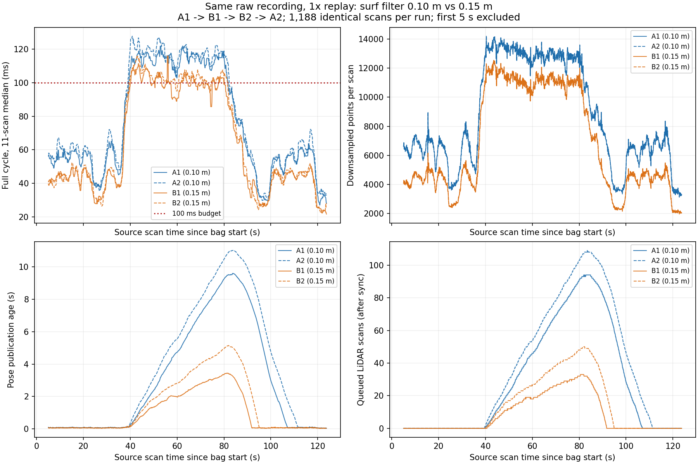

# 体素降采样 0.10 m 与 0.15 m：同包回放时延对比（2026-11-18）

结论：0.15 m 有效降低点数及 LIO 处理耗时，但本次两轮都仍出现数秒位姿延迟，尚未解决队列积压。

## 本次提交的阶段状态

- 调整的是当前帧体素降采样尺寸 `preprocess.filter_size_surf: 0.10 → 0.15`，即 10 cm → 15 cm。地图的 `lio.voxel_size: 0.5` 和 `lio.max_layer: 2` 未修改，不能将本次操作表述为修改了地图体素层级。
- 已确认收益：相同扫描的完整周期平均耗时下降 15.9%，LIO 状态估计平均耗时下降 19.7%。
- 仍未解决：完整周期 P95 为 109.71 ms，22.9% 的周期超过 100 ms；0.15 两轮仍分别积压至 33/50 帧，位姿最高滞后 3.449/5.146 秒。保留为性能改善的阶段版本，不将问题标记为已修复。
- 尚待定位：LIO 状态估计内部残差匹配、矩阵构造/求解、日志与调度等待各占多少。下一步继续细分耗时并用同包验证；本次没有实施进一步算法或线程修改。
- 同时纳入可复查的四轮回放脚本、参数确认、统计、曲线及根目录 `.gitignore`。原始 rosbag 和大体积计时 CSV 留在本机数据目录。

## 实验条件

- 原始包：`/home/nvidia/fastlivo_timing/outdoor_bags/handheld_20261115_202612`，约 123.838 秒。只以 1x 回放 `/livox/imu` 和 `/livox/lidar`。
- 同一计时可执行程序，SHA256 `6e0aac40e99416ea24be80db34d35585edfd0ed8be2bbe263eb815b031cc2687`；包含 TF 广播器复用和 Path 限长/降频。四轮顺序 A1(0.10) → B1(0.15) → B2(0.15) → A2(0.10)。
- 使用域 176、ROS_LOCALHOST_ONLY=1；未启动导航或机器人驱动。两组使用同一 YAML 和相机配置，仅用命令行覆盖 `preprocess.filter_size_surf`，并在每轮启动后通过参数服务读取确认。
- 使用 /clock 200 Hz、use_sim_time=true；每轮播放完成后额外等待 30 秒收尾。源码配置、安装程序和传感器处理算法未为对比而修改。
- 剔除原始时间前 5 秒，四轮共有 **1188 个相同扫描结束时间**，每个参数合计 **2376 个周期**。P95/P99 采用 nearest rank。
- 四轮均完整接收 24,771 条 IMU、1,238 帧 LiDAR，完成 1,238 个完整处理周期。初始化消耗不同：A1/B1/B2 各发布 1,235 条 odom，A2 发布 1,236 条；对比使用初始化之后相同扫描，未强行把启动差异当成性能收益。
- 未固定 CPU 频率、未关闭其他桌面进程；四轮记录 tegrastats。交叉重复用于观察运行波动，结果不等同于无噪声的 CPU 净耗时。

## 相同扫描汇总

| 指标 | 0.10 m，两轮合并 | 0.15 m，两轮合并 | 变化 |
|---|---:|---:|---:|
| 平均下采样点数 | 8752 | 6888 | -21.3% |
| 完整周期平均 | 77.52 ms | 65.21 ms | -15.9% |
| 完整周期 P95 | 123.64 ms | 109.71 ms | -11.3% |
| 完整周期最大 | 172.84 ms | 159.24 ms | -7.9% |
| LIO 状态估计平均 | 61.07 ms | 49.05 ms | -19.7% |
| LIO 状态估计 P95 | 100.14 ms | 86.97 ms | -13.2% |
| IMU 处理平均 | 2.21 ms | 2.31 ms | +4.6% |
| 体素地图更新平均 | 6.33 ms | 6.07 ms | -4.2% |
| 超过 100 ms 的周期 | 846/2376（35.6%） | 545/2376（22.9%） | 仍未达到持续实时 |

## 每轮结果与积压

| 轮次 | 体素边长 | 周期平均 | 周期 P95 | 最大实际位姿年龄 | 同步后 LiDAR 队列峰值 |
|---|---:|---:|---:|---:|---:|
| A1 | 0.10 m | 76.20 ms | 121.10 ms | 9.598 秒 | 94 帧 |
| A2 | 0.10 m | 78.83 ms | 125.66 ms | 11.013 秒 | 109 帧 |
| B1 | 0.15 m | 64.29 ms | 108.01 ms | 3.449 秒 | 33 帧 |
| B2 | 0.15 m | 66.13 ms | 111.16 ms | 5.146 秒 | 50 帧 |

这里位姿年龄使用发布时节点 ROS 时间减实际扫描结束时间，不使用填为 now() 的 odom/TF header 判断新旧。队列值取完成同步之后，同步前通常还包含待取走的当前扫描。
播放结束后 /clock 会冻结。额外用播放期间的 ROS 时间与单调时间差中位数，将发布单调时刻映射回源时钟，保存 wall_mapped_publish_age_ms，避免尾部输出因时钟冻结显得过新；对应映射偏差保存在 comparison.json。

## 如何解释

雷达每 100 ms 输入一帧。0.15 m 减少约 21.3% 的下采样点，LIO 状态估计平均降低约 19.7%，完整周期平均降低约 15.9%。收益主要来自状态估计；IMU 耗时没有相应降低，体素地图更新仅小幅下降。
但 0.15 m 的完整周期 P95 仍约 110 ms，两轮仍积压至 33 和 50 帧，位姿年龄最高 3.45 和 5.15 秒。因此可以认定它缓解了当前负载，不能据此认定积压已经解决。
40–100 秒相同源扫描的高负载窗口单独统计在 comparison.json/high_load。窗口平均值仍会混合爬升、持续高点数与回落阶段，不能替代逐帧时延和队列曲线。

## 精度和现场结论的边界

这份包从定位运行中途开始记录，回放会重新初始化 IMU 和地图；原现场的预先构建地图和导航/高程并发负载没有一并恢复。因此本次 0.10 对比 0.15 应使用本次同条件回放数值，不能直接与旧现场最大 12.475 秒当作严格 A/B。
匹配相同扫描时，A1 对 B1 的位置差最大约 0.153 m，A2 对 B2 最大约 0.113 m；同参数重复 A1 对 A2 最大约 0.112 m、B1 对 B2 最大约 0.026 m。原包无外部位姿真值，这些是输出差异，无法据此判断谁更准确或断言精度不变。
参数改变不修改 TF 树结构、坐标系名称、时间戳语义、队列上限或线程模型；采样点变化会影响估计出来的位姿数值。
测试通过命令行覆盖参数。源码 nav_test.yaml 保持用户已有的 0.15；独立计时安装的默认 nav_test.yaml 仍是 0.1，本次未部署修改到该安装或正式启动脚本。

## 验证和证据

- 四轮节点、播放器、观察器均正常退出；输入计数、公共扫描匹配和 TF/odom 位姿一致性已核验，四轮 TF 广播器各创建一次。
- 本次只增加/扩展 Python 回放与统计脚本，没有修改 C++，未重新构建或替换定位可执行程序。
- [机器可读完整对比](surf-filter-ab-20261118/comparison.json)、[公共扫描逐帧数据](surf-filter-ab-20261118/matched_frames.csv)、[运行清单](surf-filter-ab-20261118/manifest.json)。
- 同目录保留每轮命令、参数服务结果、退出码、输出计数及 tegrastats；完整原始计时、节点日志及回放输出保留在 `/home/nvidia/fastlivo_timing/surf_filter_ab_20261118_01`。
- 复算统计：`python3 scripts/summarize_surf_filter_ab.py /home/nvidia/fastlivo_timing/surf_filter_ab_20261118_01`。
