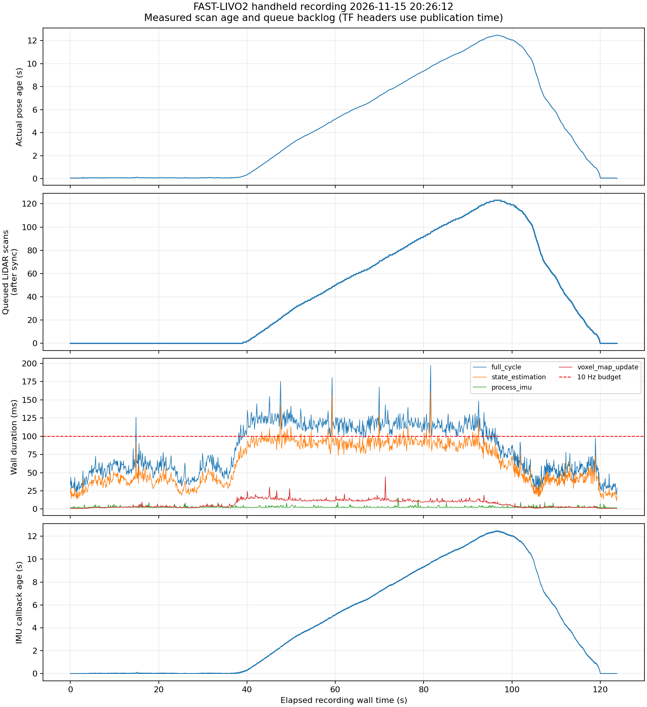

# 2026-11-15 手持录包：时延与队列积压分析

结论：两项已有修改已生效，但“定位不积压”的目标尚未达到。最新包中间出现持续处理超时，实际位姿延迟最高 12.475 秒，LiDAR 内部队列同步前最多 124 帧。后段处理负载降低后，队列才被追赶清空。

本次只做离线读取、统计与代码追踪，没有修改定位算法、参数、TF、线程或队列，也没有启动回放、导航或机器人运动。

## 当前问题状态与版本记录

本报告基于包含以下三个已有提交的定位版本；本次提交补充录包说明、分析文档及可复查统计，不包含新的运行逻辑修改。

| 项目 | 状态 | 已有修改或本次证据 | 尚未完成的部分 |
|---|---|---|---|
| 缺少分段计时、队列与实际状态年龄观测 | 已加入并在本次采集验证 | `9682304`：可选计时，记录回调、同步、IMU、LIO、地图和发布 | 还需细分 LIO 状态估计内部步骤 |
| 每帧重新创建 TF 广播器 | 已修复，本次运行验证生效 | `2eaba00`：改为每个定位实例创建一次；本次整个会话只创建 1 次 | 这项修复不保证其他阶段不会超时 |
| `/path` 历史无限增长及逐帧发布 | 已修复，本次运行验证限长、降频生效 | `16c3826`：最多 2,000 点、最多约 1 Hz；本次完整会话最大长度 2,000 | 本次有效发布跨度约 231 秒，不代替数小时现场验证 |
| 高负载时定位处理速度低于雷达输入 | **仍存在，已定位到主要耗时阶段** | 每帧约 115–125 ms；主要在 LIO 状态估计与地图更新 | 残差匹配、矩阵构造/求解、日志和 CPU 调度尚未分开测量 |
| LiDAR 队列积压和 IMU 回调消费滞后 | **仍存在** | LiDAR 同步前最多 124 帧；IMU 回调消息年龄最高 12.485 秒 | 不能仅观察 IMU 应用层队列长度；还需解决消费速度不足 |
| 发布的位姿已旧，但 odom/TF header 使用当前时刻 | **仍存在，未修改时间戳语义** | 实际扫描年龄最高 12.475 秒；header 表面接近当前时间 | 下游只看 header 或平均 Hz 无法判断实际状态新旧；本阶段保持原行为 |
| IMU 传感器故障、积分计算慢导致本次十几秒延迟 | 当前证据不支持这一主要归因 | 原始 IMU 约 200 Hz，到录包器 P95 1.741 ms；IMU 处理平均 2.560 ms | 这不是对传感器全部性能或标定的认证 |
| 室内/室外定位精度、导航转圈的完整因果链 | 尚未证明全部原因 | 本次确认高点数阶段的处理超时与积压；TF 和 odom 同时刻位姿一致 | 无独立位姿真值；不能把此次时延结论扩展为精度已验证或转圈唯一原因已确认 |

正常启动脚本仍使用原安装；本次数据使用 `start_all_height_jump_timing.sh` 的计时安装。时延问题尚未解决前，不能把“已有两个瓶颈修复”理解为“整个定位链路已经实时”。

## 数据与核验方法

- 最新包：[handheld_20261115_202612](/home/nvidia/fastlivo_timing/outdoor_bags/handheld_20261115_202612)，时长 123.838 秒。
- 对应 CSV：[events.csv](/home/nvidia/fastlivo_timing/session_20261115_202458.erzjsp/run_1794745502735169375_9436/events.csv)。完整计时会话包含 2,324 次有效位姿发布，首末有效发布间隔 231.444 秒；录包覆盖其中 1,239 次。
- 对照短包：[handheld_20261115_202254](/home/nvidia/fastlivo_timing/outdoor_bags/handheld_20261115_202254)，38.207 秒。
- SQLite 只读打开，quick_check 通过。原始文件大小、mtime、SHA256 保存到统计 JSON 的 manifest。
- 最新包 24,771 条 IMU、1,238 条 LiDAR、1,239 条 odom，均按各自 header 时间一对一匹配到计时记录，最大时间匹配误差 0.239 微秒。LiDAR 的轻量 CDR 解析与实际 ROS 消息反序列化交叉验证了 3 帧。
- 最新包 1,239 条 odom 均有同时间戳的 `camera_init -> aft_mapped` TF，位置完全一致，姿态在四元数 q/-q 等价后最大分量差 3.34e-16。对照短包 382 条 odom 中 381 条有匹配 TF，只有录包开头第一条 odom 没有对应 TF；该 odom 时间早于第一条录到的对应 TF 81.2335 ms，统计不把它算成姿态不一致。
- 延迟定义：`odom_publish.ros_s - scan_end_s`，即发布时刻减实际更新到的扫描结束时刻。不能使用 odom/TF 的 header 新旧代替：现有源码依然把它们的 header 填为发布时的 now()。
- P95/P99 使用 nearest rank；完整处理周期包含成功同步那轮 spin、同步、IMU、LIO、地图和发布，不包含之前等待同步失败的循环。因此同时检查实际发布间隔、扫描时间推进速度及消息年龄。

## 最新包的实际经过

以下时间相对录包中第一条匹配的 odom 发布时刻。队列长度取同步完成后；同步前会多出当前正在取走的一帧。

| 录包经过 | 有效输出 | 平均完整处理周期 | 平均 LIO 状态估计 | 平均体素地图更新 | 平均实际位姿延迟 | LiDAR 队列最大值 |
|---|---:|---:|---:|---:|---:|---:|
| 0–10 秒 | 100 帧 | 46.24 ms | 31.85 ms | 1.55 ms | 0.068 秒 | 0 |
| 30–40 秒 | 98 帧 | 68.62 ms | 48.81 ms | 6.39 ms | 0.103 秒 | 2 |
| 40–50 秒 | 73 帧 | 124.98 ms | 95.68 ms | 15.28 ms | 1.638 秒 | 28 |
| 50–60 秒 | 78 帧 | 117.05 ms | 92.31 ms | 11.92 ms | 4.091 秒 | 50 |
| 60–70 秒 | 80 帧 | 115.03 ms | 89.58 ms | 12.63 ms | 6.147 秒 | 70 |
| 70–80 秒 | 79 帧 | 116.60 ms | 91.94 ms | 11.86 ms | 8.292 秒 | 92 |
| 80–90 秒 | 80 帧 | 114.35 ms | 90.54 ms | 10.76 ms | 10.394 秒 | 111 |
| 90–100 秒 | 92 帧 | 97.32 ms | 76.77 ms | 8.63 ms | 12.134 秒 | 123 |
| 100–110 秒 | 164 帧 | 51.23 ms | 38.38 ms | 2.36 ms | 9.126 秒 | 119 |
| 110–120 秒 | 156 帧 | 54.48 ms | 42.01 ms | 2.31 ms | 2.868 秒 | 56 |
| 120 秒后，约 3.8 秒 | 39 帧 | 30.68 ms | 19.85 ms | 0.90 ms | 0.052 秒 | 0 |

40–90 秒持续只能处理约 7.3–8 Hz 的扫描，而输入约 10 Hz。100–120 秒输出超过 10 Hz 是消费历史积压，不能理解为这时发布的每一帧都是实时位姿。全包平均输出约 10 Hz 掩盖了中间掉速与后段追赶。

## 最直接的积压证据

在 **20:27:49.985** 发布的一帧里，状态实际只更新到 **20:27:37.510**，已经旧了 **12.475 秒**。

同一帧 1563 的同步前记录：

- LiDAR 队列 124 帧，最旧扫描起始时间 `1794745657.4244404`，最新 `1794745669.7239718`，内部队列跨度约 12.300 秒。
- 同步取走一帧后还剩 123 帧。
- IMU 内部队列 21 条，时间范围 `1794745657.413984` 至 `1794745657.5122523`。队列不长，但整段 IMU 已经落后当前时刻约 12 秒。
- 此帧 IMU 处理只耗时 2.422 ms；LIO 状态估计 84.423 ms；完整周期 102.033 ms。

说明有两处等待：LiDAR 的历史数据明确堆在应用层队列；IMU 大量延迟发生在进入 `imu_cbk()` 之前的接收/回调执行路径。没有直接测量 DDS 队列条数，不能把 IMU 内部 21 条当作所有未处理消息的数量。

## 哪些修改生效了

1. **TF 广播器生命周期修改生效。** 整个最新计时会话只记录一次 `tf_broadcaster_create`。录包期间 odom/TF 发布总耗时平均 0.630 ms、P95 1.830 ms、最大 6.286 ms，没有复现原来每帧创建广播器约 100 ms 的尖峰。
2. **Path 上限与降频生效。** 完整会话中 path 最大长度严格为 2,000；录包期间实际收到 117 条 `/path`，约 0.95 Hz。实际发出快照的调用平均 1.963 ms、P95 3.299 ms、最大 4.634 ms；整个会话实际快照调用最大 4.649 ms。未再出现旧长时运行中每帧约 86 ms 的 Path 发布负担。
3. **总的实时性仍未满足。** 录包期间 1,239 个周期有 438 个超过 100 ms，约 35.4%；位姿年龄中位数 3.451 秒、P95 12.081 秒、最大 12.475 秒。包末回落到 45.8 ms，只说明最终追赶完成。

## IMU 是否坏了、是不是 IMU 计算慢

本次证据不支持把主要问题归为 IMU 硬件或 IMU 积分太慢：

- 原始 IMU header 推进约 200.002 Hz，平均间隔 5.000 ms，无重复或回退；最大间隔 36.365 ms，超过 30 ms 的间隔只有 3 次。
- IMU 到录包器的消息年龄中位数 0.413 ms、P95 1.741 ms、最大 18.293 ms，远小于定位内部观察到的十多秒滞后。
- 录包内 24,771 条 IMU 均匹配到状态为 accepted 的回调，无回退/超过 0.2 秒跳变拒收。完整会话启动前有 152 条“尚无首帧雷达”被忽略，属于另一阶段。
- `processImu()` 平均 2.560 ms、P95 4.755 ms、最大 15.761 ms。
- 定位节点 IMU 回调的消息年龄最大 12.485 秒，说明原始数据已经到机器，但定位晚了才取到它。1217 个超过 30 ms 的 IMU 回调间隔全部与完整处理周期重叠，处理周期覆盖这些间隔总时长的约 97.0%。

LiDAR 原始输入也未出现十几秒运输延迟：每帧采集跨度平均约 100.083 ms，录包接收时距扫描结束平均 26.076 ms、P95 36.423 ms。定位中的十几秒滞后是在后续消费过程中累积的。

## 当前耗时最大的代码段

| 阶段 | 最新包平均 | P95 | 最大 | 源码位置 |
|---|---:|---:|---:|---|
| 成功轮次 spin | 1.512 ms | 4.959 ms | 20.472 ms | `LIVMapper.cpp:735` 附近 |
| 数据同步 | 0.018 ms | 0.032 ms | 0.367 ms | `sync_packages()`，`LIVMapper.cpp:1219` |
| IMU 处理 | 2.560 ms | 4.755 ms | 15.761 ms | `processImu()`，`LIVMapper.cpp:369` |
| LIO 状态估计 | 58.124 ms | 98.269 ms | 161.454 ms | `handleLIO()` 调用，`LIVMapper.cpp:507`；`voxel_map.cpp:367` 的 `StateEstimation()` |
| 地图协方差和更新，包含下一行 | 8.181 ms | 17.669 ms | 46.661 ms | `LIVMapper.cpp:553` |
| 体素地图更新 | 6.283 ms | 14.635 ms | 44.259 ms | `LIVMapper.cpp:566` |
| odom/TF 发布 | 0.630 ms | 1.830 ms | 6.286 ms | `publish_odometry()`，`LIVMapper.cpp:1655` |
| Path 调用，包含未到发布周期的快速返回 | 0.188 ms | 1.794 ms | 4.634 ms | `publish_path()`，`LIVMapper.cpp:1698` |
| 完整处理周期 | 76.808 ms | 126.010 ms | 197.225 ms | `run()`，`LIVMapper.cpp:688` |

不同阶段存在包含关系，不应直接把所有行相加。阶段耗时是墙钟时间，包含计算、日志与被其他进程抢占的时间，不等同于 CPU 净计算时间。

最慢帧 1440：完整周期 197.225 ms，其中状态估计 161.454 ms、IMU 2.962 ms、体素更新 14.635 ms、odom 发布 6.286 ms；Path 此帧没有发快照，只耗 0.0028 ms。该帧无法用 TF 广播器重建或 Path 历史增长解释。

负载变化与下采样点数有明确对应：0–10 秒每帧平均约 5,198 点、状态估计 31.85 ms；40–50 秒约 13,457 点、状态估计 95.68 ms。有效匹配点约 4,578 → 11,641；迭代次数约 4.87 → 5，并没有迭代次数暴涨。后段地图仍有约十万个体素，但点数回落后周期恢复，不能单凭地图总体大小断言它是唯一原因。

因此，目前可以定位到“高点数阶段的 LIO 状态估计和地图更新耗时超过处理预算，串行处理阻塞回调与队列消费”。还不能分清状态估计内部的残差匹配、矩阵构造/求解、日志开销和系统调度各占多少，也没有 CPU/温度/频率历史记录用来排除共享算力争用。

## 对照短包和下一步

较早 38 秒短包中，周期平均 53.820 ms、P95 80.077 ms；实际位姿年龄最高 0.485 秒，同步前 LiDAR 队列最多 4 帧，后半段恢复。它没有覆盖最新包那段持续高负载，因此不能拿短包正常来判定问题彻底解决。

下一步应继续缩小 `VoxelMapManager::StateEstimation()` 内部的耗时范围：逐迭代记录点变换/协方差、`BuildResidualListOMP()`（约 430 行）、雅可比与权重构造（约 449 行）、矩阵求解和状态更新（约 495 行）；同时关联已有点数、有效匹配数和迭代数，并记录运行时 CPU 负载/频率。先用这次同一份原始包做隔离回放比较，再决定下采样或日志等最小修改。当前没有修改这些参数，也没有用丢弃旧帧掩盖处理速度不足。

## 可复查文件

下列分析副本随本报告纳入同一个 Git 提交；原始 rosbag 和计时 CSV 仍保留在上文原目录，未加入 Git。分析脚本通过已纳入导航项目 Git 的 `docs/analysis/indoor_imu_2026-11-12_210002/analyze.py` 复用解析和统计函数，运行时需要本机 ROS Humble、ws_livox 安装与该导航项目。

- [完整统计 latest_metrics.json](ws_livox/src/FAST-LIVO2-master/docs/outdoor-timing-20261115_202612/latest_metrics.json)
- [逐 10 秒阶段及峰值原始行 phases.json](ws_livox/src/FAST-LIVO2-master/docs/outdoor-timing-20261115_202612/phases.json)
- [逐帧实际扫描时间与发布延迟](ws_livox/src/FAST-LIVO2-master/docs/outdoor-timing-20261115_202612/latest_matched_odometry.csv)
- [对照短包统计](ws_livox/src/FAST-LIVO2-master/docs/outdoor-timing-20261115_202612/earlier_metrics.json)
- [文件未变、时间匹配与 TF/odom 核验结果](ws_livox/src/FAST-LIVO2-master/docs/outdoor-timing-20261115_202612/verification.json)
- [只读分析脚本](ws_livox/src/FAST-LIVO2-master/docs/outdoor-timing-20261115_202612/analyze.py) 和 [分段与绘图脚本](ws_livox/src/FAST-LIVO2-master/docs/outdoor-timing-20261115_202612/phases.py)

复算：先 source ROS Humble 和 ws_livox 的 install/setup.bash，然后依次运行上述两个 Python 脚本。它们不会创建 ROS 节点或发布任何消息。
